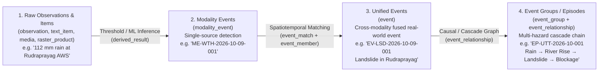
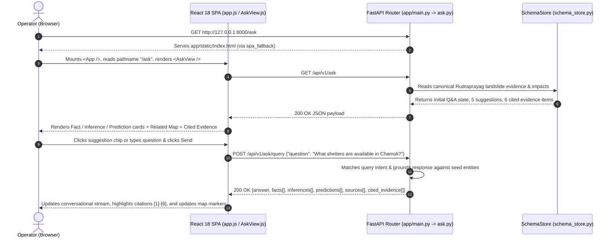

# Disaster Intelligence Multimodal Platform — Master Codebase & Architecture Guide (Basic to Advanced)

> **Project**: *Development of an Integrated Intelligent Disaster Management System for Mountain Communities in India* (Uttarakhand Testbed)  
> **Workspace Root**: [`c:/Users/ashut/Projects/disaster_data_downloader`](file:///c:/Users/ashut/Projects/disaster_data_downloader)  
> **Architecture**: FastAPI (Python 3.13) + 38-Table In-Memory Relational Schema Store + Zero-Node React 18 SPA (Tailwind CSS, Leaflet 1.9.4, Chart.js 4.4.2)  
> **Verification Status**: **367 / 367 Automated E2E & Adversarial Tests Passing (100%)**

---

## Table of Contents

1. [Part 1: The Big Picture (Basic Concepts & Domain Foundations)](#part-1-the-big-picture-basic-concepts--domain-foundations)
2. [Part 2: Complete Repository Structure & File Map](#part-2-complete-repository-structure--file-map)
3. [Part 3: Database Schema Architecture (All 38 Tables, 28 Enums & 92 Foreign Keys)](#part-3-database-schema-architecture-all-38-tables-28-enums--92-foreign-keys)
4. [Part 4: Backend Architecture Deep-Dive (FastAPI & Schema Store)](#part-4-backend-architecture-deep-dive-fastapi--schema-store)
5. [Part 5: REST API Reference (All 11 Endpoint Modules)](#part-5-rest-api-reference-all-11-endpoint-modules)
6. [Part 6: Frontend Architecture Deep-Dive (Zero-Node React 18 SPA)](#part-6-frontend-architecture-deep-dive-zero-node-react-18-spa)
7. [Part 7: The 10 Dashboard Views — Component & State Breakdown](#part-7-the-10-dashboard-views--component--state-breakdown)
8. [Part 8: End-to-End Data Flow & Request Lifecycle](#part-8-end-to-end-data-flow--request-lifecycle)
9. [Part 9: The 5-Tier Testing & Adversarial Verification Suite (367 Tests)](#part-9-the-5-tier-testing--adversarial-verification-suite-367-tests)
10. [Part 10: Developer Handbook — Running, Modifying & Extending the Platform](#part-10-developer-handbook--running-modifying--extending-the-platform)

---

## Part 1: The Big Picture (Basic Concepts & Domain Foundations)

### 1.1 What Problem Does This Platform Solve?
During a mountain disaster in Uttarakhand (such as an extreme monsoon cloudburst in Rudraprayag or Chamoli), emergency operators receive fragmented, conflicting signals from many different modalities:
- **Ground Gauges (Tabular)**: Central Water Commission (CWC) river telemetry stations reporting hourly rainfall ($\text{mm}$) and water levels ($\text{m}$).
- **Weather Grids & Satellites (Raster)**: IMD $0.25^\circ$ gridded rainfall, MOSDAC INSAT-3DR half-hourly rain rates, and ISRO Bhoonidhi EOS-04 C-band Synthetic Aperture Radar (SAR) flood inundation maps.
- **Static Terrain Layers (Geospatial Reference)**: Bhuvan CartoDEM $30\text{ m}$ slope/aspect rasters, Land Use Land Cover (LULC), and Geological Survey of India (GSI) historical landslide inventories.
- **Unstructured Reports & Multimedia (Text / Image / Video)**: News articles (PIB, PTI, local media), social media SOS posts (X/Twitter, YouTube, Telegram) in English and Hindi, and official SDMA/NDMA bulletins.

Instead of showing raw, disconnected files, this platform **fuses** those multimodal streams into a unified, evidence-grounded operational picture.

### 1.2 The 4-Level Intelligence Hierarchy
To understand both the database schema and the 10 dashboard views, you only need to understand this 4-level ladder:



1. **Canonical Observations & Items** ([`ReportsView.js`](file:///c:/Users/ashut/Projects/disaster_data_downloader/app/static/js/views/ReportsView.js)): A single tweet, a single news article, a single CWC gauge reading, or a single satellite scene.
2. **Modality Events** ([`ModalityEventsView.js`](file:///c:/Users/ashut/Projects/disaster_data_downloader/app/static/js/views/ModalityEventsView.js)): An event detected within *one* modality (e.g., an weather threshold trigger from IMD, or a landslide detection from news reports).
3. **Unified Events** ([`EventsView.js`](file:///c:/Users/ashut/Projects/disaster_data_downloader/app/static/js/views/EventsView.js)): When a weather modality event, a news modality event, and a social media modality event all point to the same landslide in Rudraprayag at the same time, they are matched (`event_match`) and merged into one canonical **Unified Event** (`event`), with conflict resolution (`event_attribute_selection`) choosing the most reliable source for each headline attribute.
4. **Event Groups / Episodes** ([`EventGroupsView.js`](file:///c:/Users/ashut/Projects/disaster_data_downloader/app/static/js/views/EventGroupsView.js)): Disasters in mountain terrain cascade. Heavy rainfall triggers river level rise and slope failure (landslide), which causes highway blockage (`NH-58`/`NH-07`), which risks secondary flooding. An **Episode** (`event_group`) links multiple unified events into a directed causal graph (`event_relationship`).

### 1.3 Epistemic Status Taxonomy (How the Platform Labels Truth)
Every badge across the UI (defined in [`Badges.js`](file:///c:/Users/ashut/Projects/disaster_data_downloader/app/static/js/components/Badges.js)) communicates *how* we know something:
- **Observed** (`#10b981` Emerald): Directly measured by physical sensors or verified satellite pass.
- **Official** (`#0ea5e9` Sky Blue): Issued by an authoritative government agency (IMD, CWC, NDMA, USDMA, GSI).
- **Reported** (`#3b82f6` Blue): Stated in news media or eyewitness field reports.
- **AI Inferred** (`#a855f7` Purple): Extracted or classified by an ML model (`derived_result`) from current data.
- **Predicted** (`#f59e0b` Amber): Forecasted for a future time window by a predictive susceptibility/hydrology model.
- **Unverified** (`#ef4444` Red): Raw crowdsourced/social media claim not yet corroborated.

---

## Part 2: Complete Repository Structure & File Map

```text
disaster_data_downloader/
├── app/                                      # Main Application Package (Backend + Static SPA)
│   ├── main.py                               # FastAPI entrypoint, CORS, /health, /static mount, SPA router
│   ├── core/
│   │   ├── config.py                         # Pydantic Settings (paths, prefixes, project metadata)
│   │   ├── parsed_schema.json                # Compiled JSON AST of all 38 DBML tables, 28 enums, 92 FKs
│   │   └── schema_store.py                   # In-memory singleton managing schema metadata & seed records
│   ├── mock_data/
│   │   ├── generator.py                      # Deterministic generator building 177 relational records
│   │   └── seed_data.json                    # Pre-generated 122 KB JSON database for all 38 tables
│   ├── api/
│   │   └── v1/
│   │       ├── api.py                        # Master APIRouter mounting all 11 domain sub-routers
│   │       └── endpoints/                    # 11 Domain Route Modules
│   │           ├── tables.py                 # Schema inspection (/api/v1/tables & /api/v1/tables/{name})
│   │           ├── overview.py               # View 1: Overview KPIs, map, charts, regions, source health
│   │           ├── map_explorer.py           # View 2: GeoJSON layers, spatial bbox filters, timeline
│   │           ├── events.py                 # View 3: Unified events list, filters, 7-tab detail dossier
│   │           ├── modality_events.py        # View 4: Single-modality detections & ML/sensor provenance
│   │           ├── event_groups.py           # View 5: Multi-hazard episodes & causal DAG graphs
│   │           ├── reports.py                # View 6: Reports feed, bilingual EN/HI translation, reliability
│   │           ├── history.py                # View 7: 2015–2025 trends, seasonality, landslide inventory
│   │           ├── preparedness.py           # View 8: Shelters, contacts, relief resources, safety guides
│   │           ├── ask.py                    # View 9: Evidence-grounded Q&A (Fact/Inference/Prediction)
│   │           └── my_area.py                # View 10: Watchlist CRUD & user notification/display settings
│   └── static/                               # Zero-Node React 18 Frontend Assets
│       ├── index.html                        # HTML5 entrypoint loading vendored libs & JSX scripts
│       ├── css/
│       │   └── app.css                       # Custom animations, pulsing map markers, dark scrollbars
│       ├── vendor/                           # Locally vendored React 18, ReactDOM, Babel, Leaflet, Chart.js, Tailwind
│       └── js/
│           ├── app.js                        # Root <App /> component, URL sync, 10-view router switch
│           ├── components/                   # 7 Reusable UI Building Blocks
│           │   ├── Sidebar.js                # Dark navy (#0d1b2a) left navigation bar
│           │   ├── TopBar.js                 # Global search, country/state/date selectors, profile pill
│           │   ├── KpiCard.js                # Metric card with delta badges & icons
│           │   ├── Badges.js                 # Epistemic status & severity badge components
│           │   ├── MapView.js                # Interactive Leaflet wrapper with layer & basemap controls
│           │   ├── ChartView.js              # Chart.js wrapper (Doughnut, Line, Stacked/Horizontal Bar)
│           │   └── EpisodeGraph.js           # Horizontal causal DAG renderer for cascading episodes
│           └── views/                        # 10 Full-Screen Dashboard Views
│               ├── OverviewView.js           # View 1 (matches image7.png)
│               ├── MapExplorerView.js        # View 2 (matches image6.png)
│               ├── EventsView.js             # View 3 (matches image4.png)
│               ├── ModalityEventsView.js     # View 4 (matches image8.png)
│               ├── EventGroupsView.js        # View 5 (matches image9.png)
│               ├── ReportsView.js            # View 6 (matches image10.png)
│               ├── HistoryTrendsView.js      # View 7 (matches image1.png)
│               ├── PreparednessView.js       # View 8 (matches image2.png)
│               ├── AskView.js                # View 9 (matches image5.png)
│               └── MyAreaView.js             # View 10 (matches image3.png)
│
├── schemas/                                  # Database Schemas
│   ├── dbdiagram_schema.dbml                 # Official 38-table PostgreSQL 16 + PostGIS DBML specification
│   ├── dbdiagram_schema.json                 # Full diagram layout & metadata from dbdiagram.io
│   └── schema.sql                            # Prototype PostgreSQL + PostGIS star schema DDL
│
├── data/                                     # Raw & Processed Earth Observation Data
│   ├── extracted_readable/                   # Clean CSV/GeoJSON/GeoTIFF samples extracted from raw feeds
│   ├── docx_extracted_images/                # 10 high-res UI reference screenshots (image1.png–image10.png)
│   ├── pdf_extracted_texts/                  # UTF-8 text extractions of all project specification PDFs/DOCX
│   ├── hydrology/                            # Raw CWC Uttarakhand hourly telemetry CSV
│   ├── imd/                                  # Raw IMD .grd & .nc rainfall grids
│   ├── mosdac/                               # Raw INSAT-3DR .h5 satellite files
│   └── hazard_maps/                          # Raw Bhoonidhi EOS-04 SAR & Bhuvan WMS layers
│
├── scripts/                                  # Data Engineering & Extraction Scripts
│   ├── data_pipeline/                        # Downloaders (IMD, MOSDAC, Bhuvan) & sample extractors
│   └── tools/                                # Schema & API inspection utilities
│
├── docs/                                     # Project Documentation
│   ├── project_specs/                        # Official PDFs & DOCX specifications
│   └── guides/                               # Data catalog, schema guide, and this codebase master guide
│
└── tests/                                    # 367-Test 5-Tier Automated Verification Suite
    ├── test_harness.py                       # Background Uvicorn test server manager & HTTP client
    ├── test_runner.py                        # Standalone CLI test runner (--tier 1|2|3|4|5|all)
    ├── tier1_features/                       # 164 tests: 38 tables, 10 views, static & UI contracts
    ├── tier2_boundaries/                     # 84 tests: SQLi, malformed inputs, 404s, pagination limits
    ├── tier3_combinations/                   # 28 tests: multi-filter intersections, DAG chains, state lifecycle
    ├── tier4_scenarios/                      # 6 tests: end-to-end multi-step operator workflows
    └── tier5_adversarial/                    # 85 tests: concurrency stress, fuzzing, geo extremes, SPA routing
```

---

## Part 3: Database Schema Architecture (All 38 Tables, 28 Enums & 92 Foreign Keys)

The canonical database schema lives in [`schemas/dbdiagram_schema.dbml`](file:///c:/Users/ashut/Projects/disaster_data_downloader/schemas/dbdiagram_schema.dbml) and is compiled into [`app/core/parsed_schema.json`](file:///c:/Users/ashut/Projects/disaster_data_downloader/app/core/parsed_schema.json).

### 3.1 The 8 Schema Domains & All 38 Tables

| Domain Group | Tables (Count) | Purpose & Key Relationships |
| :--- | :--- | :--- |
| **1. Source Management** | `data_source`, `dataset`, `dataset_version` (3) | Registers agencies (`IMD`, `CWC`, `ISRO NRSC`, `GSI`, `NewsAPI`, `X/Twitter`), their feed modalities (`tabular`, `raster`, `text`, `image`, `video`), and versioned schemas. |
| **2. Ingestion & Provenance** | `pipeline_run`, `collection`, `raw_object`, `raw_validation`, `ingest_rejection` (5) | Tracks every scheduled/manual ingestion run, MinIO/S3 raw object URIs (`storage_uri`, `sha256`), validation pass/warn/fail logs, and rejected malformed payloads. |
| **3. Reference Data** | `hazard`, `admin_region`, `static_raster`, `geo_feature` (4) | Defines hazard taxonomy (`flood`, `landslide`, `earthquake`, `heavy_rainfall`, `cyclone`), 13 Uttarakhand districts (`admin_region` with LGD codes & polygons), static CartoDEM/LULC rasters, and critical infrastructure (`geo_feature`: shelters, hospitals, roads, bridges). |
| **4. Canonical Observations** | `observation`, `observation_region`, `observation_relation`, `text_item`, `raster_product`, `media` (6) | Stores normalized sensor readings (`observation`), news/social posts (`text_item` with original & translated text), satellite scenes (`raster_product`), and geotagged photos/videos (`media`). |
| **5. Enrichment & Derived Results** | `model`, `derived_result`, `derived_result_input` (3) | Stores AI/ML models (NER extractors, flood segmentation CNNs, landslide susceptibility random forests), their outputs (`derived_result`), and exact input lineage (`derived_result_input`). |
| **6. Source Quality** | `source_score` (1) | Tracks historical reliability, latency/freshness, and precision scores per (`source_id`, `hazard_id`, `task_type`). |
| **7. Event Intelligence** | `modality_event`, `modality_event_input`, `event_match`, `event`, `event_attribute_selection`, `event_member`, `event_evidence`, `event_region`, `event_impact`, `event_lineage`, `event_relationship`, `event_group`, `event_group_member` (13) | The core fusion engine: single-source `modality_event` detections are paired via `event_match`, merged into canonical `event` records, backed by `event_evidence` and `event_impact`, and linked into cascading `event_group` episodes via `event_relationship`. |
| **8. Benchmark Datasets** | `dataset_sample`, `dataset_sample_item`, `dataset_sample_event` (3) | Packages curated multi-hazard episodes and observations into golden ML evaluation benchmarks without duplicating canonical rows. |

### 3.2 Advanced Schema Integrity Rules (`CHECK` Constraints)
Two polymorphic lineage tables enforce strict single-target exclusivity in [`schemas/dbdiagram_schema.dbml`](file:///c:/Users/ashut/Projects/disaster_data_downloader/schemas/dbdiagram_schema.dbml) and [`app/mock_data/generator.py`](file:///c:/Users/ashut/Projects/disaster_data_downloader/app/mock_data/generator.py):
1. **`ck_derived_input_one` on `derived_result_input`**:
   Every row linking an ML inference to its raw input must have **exactly one** non-null foreign key among `(observation_id, text_item_id, raster_product_id, media_id)`:
   $$\text{num\_nonnulls}(\text{observation\_id}, \text{text\_item\_id}, \text{raster\_product\_id}, \text{media\_id}) = 1$$
2. **`ck_modality_input_one` on `modality_event_input`**:
   Every row linking a modality event to its supporting evidence must have **exactly one** non-null foreign key among `(observation_id, text_item_id, raster_product_id, media_id, derived_result_id)`:
   $$\text{num\_nonnulls}(\text{observation\_id}, \text{text\_item\_id}, \text{raster\_product\_id}, \text{media\_id}, \text{derived\_result\_id}) = 1$$

---

## Part 4: Backend Architecture Deep-Dive (FastAPI & Schema Store)

### 4.1 Application Entrypoint ([`app/main.py`](file:///c:/Users/ashut/Projects/disaster_data_downloader/app/main.py))
When you run `.\venv\Scripts\uvicorn.exe app.main:app`, FastAPI executes the following setup sequence:
1. **Lifespan Hook (`lines 18–22`)**: Calls [`schema_store.initialize()`](file:///c:/Users/ashut/Projects/disaster_data_downloader/app/core/schema_store.py#L28-L40) before accepting requests, loading all 38 table definitions and 177 seed records into memory.
2. **CORS Middleware (`lines 35–41`)**: Enables cross-origin requests across all methods and headers.
3. **API v1 Router Mount (`line 44`)**: Mounts [`api_router`](file:///c:/Users/ashut/Projects/disaster_data_downloader/app/api/v1/api.py#L21) under `/api/v1`.
4. **Health Check (`lines 48–56`)**: `GET /health` returns `{"status": "ok", "tables_loaded": 38}`.
5. **Static Assets Mount (`lines 60–62`)**: Mounts `app/static/` at `/static`.
6. **SPA Client-Side Routing Fallback (`lines 66–90`)**:
   - Requests to `/` or client view routes (`/overview`, `/map-explorer`, `/events`, `/ask`, etc.) return `app/static/index.html` so React can route to the requested view.
   - Requests starting with `api/`, `static/`, `docs`, or `openapi.json` that do not match a valid route explicitly raise `HTTPException(status_code=404)` so API errors are never masked by HTML responses.

### 4.2 Configuration ([`app/core/config.py`](file:///c:/Users/ashut/Projects/disaster_data_downloader/app/core/config.py))
[`Settings`](file:///c:/Users/ashut/Projects/disaster_data_downloader/app/core/config.py#L6-L25) is a Pydantic model that resolves all workspace paths relative to `BASE_DIR` (`c:\Users\ashut\Projects\disaster_data_downloader`), ensuring the app runs identically regardless of the current working directory.

### 4.3 The In-Memory Schema Store ([`app/core/schema_store.py`](file:///c:/Users/ashut/Projects/disaster_data_downloader/app/core/schema_store.py))
[`SchemaStore`](file:///c:/Users/ashut/Projects/disaster_data_downloader/app/core/schema_store.py#L17-L160) is the singleton data access layer (`schema_store`):
- **`_load_schema()` (`lines 41–64`)**: Reads [`app/core/parsed_schema.json`](file:///c:/Users/ashut/Projects/disaster_data_downloader/app/core/parsed_schema.json) containing:
  - `_enums`: 28 custom DBML enums (`dataset_kind`, `source_type`, `modality`, `pipeline_stage`, `epistemic_status`, `severity_level`, etc.).
  - `_table_groups`: 8 domain groupings.
  - `_tables`: Column definitions, types, primary keys, indexes, and `CHECK` constraints for all 38 tables.
  - `_refs`: All 92 foreign-key relationships (`from_table.from_col -> to_table.to_col`).
- **`_load_seed_data()` (`lines 66–84`)**: Loads [`app/mock_data/seed_data.json`](file:///c:/Users/ashut/Projects/disaster_data_downloader/app/mock_data/seed_data.json). If the JSON file is missing, it dynamically invokes [`generate_all_tables()`](file:///c:/Users/ashut/Projects/disaster_data_downloader/app/mock_data/generator.py) to rebuild the dataset on the fly.
- **Public Query Methods**:
  - `get_all_tables()`: Returns the summary catalog of all 38 tables with record counts and cleaned domain group names.
  - `get_table(table_name)`: Returns the full DDL metadata (columns, foreign keys, indexes, check constraints) plus `sample_records` for a single table, or `None` if the table does not exist.

---

## Part 5: REST API Reference (All 11 Endpoint Modules)

All domain routers are aggregated in [`app/api/v1/api.py`](file:///c:/Users/ashut/Projects/disaster_data_downloader/app/api/v1/api.py) under `/api/v1`:

| Module | Base Prefix | Endpoints | Key Features & Data Returned |
| :--- | :--- | :--- | :--- |
| **[`tables.py`](file:///c:/Users/ashut/Projects/disaster_data_downloader/app/api/v1/endpoints/tables.py)** | `/api/v1/tables` | `GET /`<br>`GET /{table_name}` | Lists all 38 DBML tables grouped by domain; returns column schemas, FKs, check constraints, and sample records per table. Returns HTTP 404 for unknown table names. |
| **[`overview.py`](file:///c:/Users/ashut/Projects/disaster_data_downloader/app/api/v1/endpoints/overview.py)** | `/api/v1/overview` | `GET /`<br>`GET /kpis`<br>`GET /alerts`<br>`GET /charts`<br>`GET /regions`<br>`GET /recent-events`<br>`GET /sources` | Powers **View 1 (`Overview`)**: 7 KPI summary cards (`Total Events: 127`, `Active: 34`, `Official Warnings: 18`, `AI Risk Alerts: 11`, `Affected Area: 1.2M`, `Regions: 48`, `Casualties: 86`), active warnings list, hazard & severity donut chart datasets, 30-day trend curves, top 5 affected Uttarakhand districts, recent 24h events (with `limit` query param), and live source status table. |
| **[`map_explorer.py`](file:///c:/Users/ashut/Projects/disaster_data_downloader/app/api/v1/endpoints/map_explorer.py)** | `/api/v1/map` | `GET /`<br>`GET /layers`<br>`GET /features`<br>`GET /feed`<br>`GET /timeline`<br>`GET /location-summary` | Powers **View 2 (`Map Explorer`)**: Layer definitions (`Events & Alerts` vs. `Environmental`), GeoJSON `FeatureCollection` supporting spatial bounding-box filtering (`min_lat`, `max_lat`, `min_lon`, `max_lon`) plus `hazard`, `severity`, `status`, and `district` filters, right-hand feed (`tab=all\|events\|warnings\|risk_alerts`), timeline playback ticks (`Sep 01 – Oct 09, 2026`), and selected district elevation/coordinate card. |
| **[`events.py`](file:///c:/Users/ashut/Projects/disaster_data_downloader/app/api/v1/endpoints/events.py)** | `/api/v1/events` | `GET /`<br>`GET /{event_id}` | Powers **View 3 (`Events`)**: Paginated (`page`, `limit`) and filterable (`hazard`, `severity`, `status`, `region`, `search`) unified events list + 6 KPI cards. `GET /{event_id}` performs a strict dictionary lookup in `EVENTS_BY_ID` (e.g. `EV-LSD-2026-10-09-001`) returning all 7 sub-tab payloads (`overview`, `timeline`, `evidence`, `modality_events`, `affected_regions`, `impacts` split into `observed` vs. `predicted`, and `related_events`). |
| **[`modality_events.py`](file:///c:/Users/ashut/Projects/disaster_data_downloader/app/api/v1/endpoints/modality_events.py)** | `/api/v1/modality-events` | `GET /`<br>`GET /{modality_event_id}` | Powers **View 4 (`Modality Events`)**: 8 modality KPIs (`Total: 482`, `Weather: 118`, `Flood: 92`, `Landslide: 74`, `Social Media: 71`, `News: 64`, `Earthquake: 36`, `Other: 27`), filterable list (`modality`, `hazard`, `region`, `status`, `type`), and detail lookup in `MODALITY_EVENTS_BY_ID` (e.g. `ME-WTH-2026-10-09-001`) with rainfall heatmap points, supporting sensor observations, ML derived results, and link to matched unified event. |
| **[`event_groups.py`](file:///c:/Users/ashut/Projects/disaster_data_downloader/app/api/v1/endpoints/event_groups.py)** | `/api/v1/event-groups` | `GET /`<br>`GET /{episode_id}` | Powers **View 5 (`Event Groups / Episodes`)**: 5 episode KPIs (`Total: 28`, `Active: 9`, `Multi-Hazard: 16`, `High Impact: 7`, `Resolved: 19`), filterable episode list, and detail lookup in `EPISODES_BY_ID` (e.g. `EP-UTT-2026-10-001`) with the 5-node causal DAG (`nodes` + `edges` labeled `Confirmed`, `Inferred`, `Reported`, `Possible`), combined impacts, and contributing events. |
| **[`reports.py`](file:///c:/Users/ashut/Projects/disaster_data_downloader/app/api/v1/endpoints/reports.py)** | `/api/v1/reports` | `GET /`<br>`GET /{report_id}` | Powers **View 6 (`Reports & Evidence`)**: 5 report KPIs (`Total: 1,248`, `Official: 186`, `News: 432`, `Social: 398`, `Multimedia: 174`), multi-facet filter bar (`source_type`, `verification_status`, `hazard`, `region`, `language`), and detail lookup in `REPORTS_BY_ID` with bilingual English (`content_en`, `key_points_en`) and Hindi (`title_hi`, `content_hi`, `key_points_hi`) fields plus `source_reliability` checklist. |
| **[`history.py`](file:///c:/Users/ashut/Projects/disaster_data_downloader/app/api/v1/endpoints/history.py)** | `/api/v1/history` | `GET /`<br>`GET /trends`<br>`GET /seasonal`<br>`GET /landslide-inventory`<br>`GET /regional`<br>`GET /compare` | Powers **View 7 (`History & Trends`)**: 10-year historical KPIs (`8,429 Total Events`), yearly (`2015–2025`) and monthly stacked bar datasets, 12-month seasonal curve (monsoon peak in Jul–Sep), GSI/Bhuvan historical landslide scar GeoJSON points, 13-district horizontal stacked bar distribution, and side-by-side comparison (`Current Oct 2026 Event` vs. `Aug 2021 Past Similar Event`). |
| **[`preparedness.py`](file:///c:/Users/ashut/Projects/disaster_data_downloader/app/api/v1/endpoints/preparedness.py)** | `/api/v1/preparedness` | `GET /`<br>`GET /shelters`<br>`GET /contacts`<br>`GET /resources`<br>`GET /guidance` | Powers **View 8 (`Preparedness & Response`)**: 4 verified KPIs (`124 Shelters`, `28 Emergency Contacts`, `46 Relief Resources`, `32 Safety Guidance` items), filterable shelters table (`district`, `status`, `search`) with coordinates and `last_verified` timestamps, and the 3-column emergency response directory. |
| **[`ask.py`](file:///c:/Users/ashut/Projects/disaster_data_downloader/app/api/v1/endpoints/ask.py)** | `/api/v1/ask` | `GET /`<br>`GET /suggestions`<br>`POST /query` | Powers **View 9 (`Ask — Evidence-Grounded Q&A`)**: Returns 5 suggested questions and processes natural-language queries via `POST /api/v1/ask/query`, returning a summary narrative, explicit `facts` (green), `inferences` (orange), and `predictions` (purple) bullet arrays with `[1]–[6]` citation tags, `key_impacts`, `sources`, `cited_evidence`, `related_events`, `related_area`, and `related_resources`. |
| **[`my_area.py`](file:///c:/Users/ashut/Projects/disaster_data_downloader/app/api/v1/endpoints/my_area.py)** | `/api/v1/my-area` | `GET /`<br>`GET /watchlist`<br>`POST /watchlist`<br>`DELETE /watchlist/{id}`<br>`GET /settings`<br>`PUT /settings`<br>`POST /reset` | Powers **View 10 (`My Area / Settings`)**: Full stateful CRUD for pinned Uttarakhand districts (`watchlist`), hazard monitoring toggles (`earthquake`, `flood`, `landslide`, `cyclone`, `extreme_weather`), notification preferences, display units (`°C`/`°F`, `mm`/`in`, `km`/`mi`), map defaults, and state reset. |

---

## Part 6: Frontend Architecture Deep-Dive (Zero-Node React 18 SPA)

### 6.1 How the Zero-Node Browser Runtime Works
Because the target Windows environment runs Python without requiring a local Node.js/npm toolchain, [`app/static/index.html`](file:///c:/Users/ashut/Projects/disaster_data_downloader/app/static/index.html) implements a **self-contained browser compilation pipeline**:
1. **Local Vendored Libraries with Automatic CDN Fallback (`lines 10–32`)**:
   Every library is loaded first from `/static/vendor/...` (for fast, offline-capable local execution) with an immediate `<script>if (!window.X) document.write(...)</script>` fallback to official CDNs:
   - `react.production.min.js` (`React 18`)
   - `react-dom.production.min.js` (`ReactDOM 18`)
   - `babel.min.js` (`@babel/standalone` — compiles `<script type="text/babel">` JSX tags directly in the browser)
   - `leaflet.js` + `leaflet.css` (`Leaflet 1.9.4`)
   - `chart.umd.min.js` (`Chart.js 4.4.2`)
   - `tailwindcss.js` (`Tailwind CSS JIT` configured with custom design tokens `brand-navy: #0d1b2a`, `brand-card: #1e293b`, `brand-dark: #0f172a`, `brand-blue: #1976d2`).
2. **Global Module Registry (`window.DisasterComponents` & `window.DisasterViews`)**:
   - Each file in `app/static/js/components/` attaches its exported React components to `window.DisasterComponents` (and `window`).
   - Each file in `app/static/js/views/` attaches its view component to `window.DisasterViews` (and `window`).
   - Finally, [`app/static/js/app.js`](file:///c:/Users/ashut/Projects/disaster_data_downloader/app/static/js/app.js) reads `window.DisasterComponents` and `window.DisasterViews`, mounts `<App />` into `<div id="root">` via `ReactDOM.createRoot`, and synchronizes view changes with the browser URL via `window.history.pushState` and `popstate` listeners.

### 6.2 Shared Reusable Components (`app/static/js/components/`)

1. **[`Sidebar.js`](file:///c:/Users/ashut/Projects/disaster_data_downloader/app/static/js/components/Sidebar.js)**:
   - Renders the fixed $256\text{ px}$ dark navy (`#0d1b2a`) left navigation bar.
   - Displays the globe emblem, `"Disaster Intelligence / Multimodal Platform"` header, the 10 primary view buttons with SVG icons, and bottom utility links (`Settings`, `Help & About`).
2. **[`TopBar.js`](file:///c:/Users/ashut/Projects/disaster_data_downloader/app/static/js/components/TopBar.js)**:
   - Renders the top global filter bar with live keyword search input, `🇮🇳 India` country pill, `Uttarakhand` state dropdown, date-range selector (`Sep 01, 2026 - Oct 09, 2026`), `Apply` button, `Live` indicator badge, notification bell with count `3`, and `AS` avatar pill.
3. **[`KpiCard.js`](file:///c:/Users/ashut/Projects/disaster_data_downloader/app/static/js/components/KpiCard.js)**:
   - Renders standardized metric cards supporting custom icon badges, big numeric values, trend delta pills (`↑ 12%`, `↑ 21%`), and sub-labels (`Ongoing events`, `Last verified: Oct 08, 2026`).
4. **[`Badges.js`](file:///c:/Users/ashut/Projects/disaster_data_downloader/app/static/js/components/Badges.js)**:
   - Exports `<EpistemicBadge status="..." />`, `<SeverityBadge severity="..." />`, and `<StatusBadge status="..." />` with consistent color coding across all 10 views.
5. **[`MapView.js`](file:///c:/Users/ashut/Projects/disaster_data_downloader/app/static/js/components/MapView.js)**:
   - A full-featured React wrapper around **Leaflet 1.9.4**:
     - Supports switching tile layers dynamically between **Satellite** (Esri World Imagery), **Terrain** (OpenTopoMap / Carto Dark Matter), and **Light / Road** (Carto Positron / OSM).
     - Renders pulsing custom HTML/SVG hazard pins (`.leaflet-marker-pulse`), GeoJSON district boundaries, and colored risk/inundation polygons (`Observed Affected Area` in red, `Forecast At-Risk Area` in amber).
     - Cleans up the Leaflet map instance on component unmount (`mapRef.current.remove()`) to prevent memory leaks or `"Map container is already initialized"` errors.
6. **[`ChartView.js`](file:///c:/Users/ashut/Projects/disaster_data_downloader/app/static/js/components/ChartView.js)**:
   - A React lifecycle wrapper around **Chart.js 4.4.2** supporting `doughnut`, `line`, and `bar` (both vertical stacked and horizontal stacked `indexAxis: 'y'`) charts.
   - Automatically destroys and recreates the `Chart` instance whenever `type`, `data`, or `options` props change.
7. **[`EpisodeGraph.js`](file:///c:/Users/ashut/Projects/disaster_data_downloader/app/static/js/components/EpisodeGraph.js)**:
   - Renders the horizontal causal cascade diagram in **View 5 (`Event Groups`)**:
     `Heavy Rainfall (Observed)` $\xrightarrow{\text{Confirmed}}$ `River Level Rise (Observed)` $\xrightarrow{\text{Inferred}}$ `Landslide (Reported)` $\xrightarrow{\text{Reported}}$ `Road Blockage (Observed)` $\xrightarrow{\text{Possible}}$ `Flooding (Predicted)`.

---

## Part 7: The 10 Dashboard Views — Component & State Breakdown

| # | View Component | Reference Screenshot | API Endpoint Consumed | Key Interactive State & UI Panels |
| :- | :--- | :--- | :--- | :--- |
| **1** | **[`OverviewView.js`](file:///c:/Users/ashut/Projects/disaster_data_downloader/app/static/js/views/OverviewView.js)** | [`image7.png`](file:///c:/Users/ashut/Projects/disaster_data_downloader/data/docx_extracted_images/image7.png) | `GET /api/v1/overview` | `mapLayer` state (`events`, `warnings`, `rainfall`, `landslide`, `boundaries`), `baseMap` switcher (`satellite`, `terrain`, `light`), 7 KPI cards, interactive map, `Active Alerts & Warnings` list, `Latest News & Reports` list, 3 charts (`Events by Hazard Type`, `Event Trend`, `Severity Distribution`), `Top 5 Affected Regions` table, `Recent Events (Last 24 Hours)` table, and `Data Source Status` health monitor. |
| **2** | **[`MapExplorerView.js`](file:///c:/Users/ashut/Projects/disaster_data_downloader/app/static/js/views/MapExplorerView.js)** | [`image6.png`](file:///c:/Users/ashut/Projects/disaster_data_downloader/data/docx_extracted_images/image6.png) | `GET /api/v1/map` | 6 top filter dropdowns (`hazard`, `severity`, `status`, `dataType`, `timeRange`, `region`), floating `Map Layers` card with `Events & Alerts` / `Environmental` tabs, layer checkboxes, `Layer Opacity` slider (`0–100%`), right-hand `Events & Warnings (42)` panel with `All` / `Events` / `Warnings` / `Risk Alerts` tabs, bottom `Timeline` scrubber with play/pause animation, `Legend`, `Selected Location` card, and `Base Map` thumbnails. |
| **3** | **[`EventsView.js`](file:///c:/Users/ashut/Projects/disaster_data_downloader/app/static/js/views/EventsView.js)** | [`image4.png`](file:///c:/Users/ashut/Projects/disaster_data_downloader/data/docx_extracted_images/image4.png) | `GET /api/v1/events`<br>`GET /api/v1/events/{id}` | 6 KPI cards, filter bar, master-detail split layout: clicking any event in the left list (`Events (127)`) fetches `GET /api/v1/events/{id}` and updates the right dossier panel (`selectedEvent`, `activeSubTab` across `Overview`, `Timeline`, `Evidence (12)`, `Modality Events (4)`, `Affected Regions (3)`, `Impacts (6)`, `Related Events (3)`), photo carousel, `Observed vs. Predicted Impacts` comparison cards, and contributing modality table. |
| **4** | **[`ModalityEventsView.js`](file:///c:/Users/ashut/Projects/disaster_data_downloader/app/static/js/views/ModalityEventsView.js)** | [`image8.png`](file:///c:/Users/ashut/Projects/disaster_data_downloader/data/docx_extracted_images/image8.png) | `GET /api/v1/modality-events`<br>`GET /api/v1/modality-events/{id}` | 8 modality KPI cards, filter bar (`modality`, `hazard`, `region`, `status`), selectable left list (`Modality Events (482)`), and right detail panel (`Heavy Rainfall Detection ME-WTH-2026-10-09-001`) with 5 sub-tabs, rainfall intensity heatmap (`0–200 mm`), `Event Classification` radio selector (`Detected Event`, `Reported Incident`, `AI Inference`, `Predicted Event`), `Supporting Observations (6)`, `Derived Results (3)`, and `Related Evidence`. |
| **5** | **[`EventGroupsView.js`](file:///c:/Users/ashut/Projects/disaster_data_downloader/app/static/js/views/EventGroupsView.js)** | [`image9.png`](file:///c:/Users/ashut/Projects/disaster_data_downloader/data/docx_extracted_images/image9.png) | `GET /api/v1/event-groups`<br>`GET /api/v1/event-groups/{id}` | 5 episode KPI cards, filter bar, selectable `Event Groups (28)` list, and right detail panel (`Rudraprayag Heavy Rainfall Episode EP-UTT-2026-10-001`) with 6 sub-tabs (`Overview`, `Event Graph`, `Timeline`, `Affected Areas`, `Impacts`, `Contributing Events (7)`, `Related Episodes (3)`), `<EpisodeGraph />` horizontal causal chain, episode map, `Episode Information`, `Combined Impacts`, and `Key Contributing Events`. |
| **6** | **[`ReportsView.js`](file:///c:/Users/ashut/Projects/disaster_data_downloader/app/static/js/views/ReportsView.js)** | [`image10.png`](file:///c:/Users/ashut/Projects/disaster_data_downloader/data/docx_extracted_images/image10.png) | `GET /api/v1/reports`<br>`GET /api/v1/reports/{id}` | 5 report KPI cards, 5-filter bar (`sourceType`, `verification`, `hazard`, `region`, `language`), selectable left list (`Reports & Evidence (1,248)`), and right detail panel with 6 sub-tabs (`Overview`, `Content & Translation`, `Related Events (3)`, `Related Reports (8)`, `Media (5)`, `Metadata`), photo gallery, `Key Information`, mini-map, side-by-side **English Original** + **Hindi Translation (`भारत मौसम विज्ञान विभाग...`)** with interactive language toggle, `Key Points`, `Related Hazards`, `Associated Locations`, and `Source Reliability` checklist. |
| **7** | **[`HistoryTrendsView.js`](file:///c:/Users/ashut/Projects/disaster_data_downloader/app/static/js/views/HistoryTrendsView.js)** | [`image1.png`](file:///c:/Users/ashut/Projects/disaster_data_downloader/data/docx_extracted_images/image1.png) | `GET /api/v1/history` | Top mode switcher (`Events Trends` vs. `Landslide Inventory`), 6 historical KPI cards (`8,429 Total Historical Events`), `Yearly` / `Monthly` toggle for `Event Trends Over Time` stacked bar chart, `Seasonal Pattern (Monthly Average)` multi-line chart, dual maps (`Historical Events Map 2015–2025` & `Landslide Inventory Historical`), `Regional Event Distribution` horizontal stacked bar chart across 11 Uttarakhand districts, `Historical Events` table with CSV export, and `Compare with Past Events` side-by-side card. |
| **8** | **[`PreparednessView.js`](file:///c:/Users/ashut/Projects/disaster_data_downloader/app/static/js/views/PreparednessView.js)** | [`image2.png`](file:///c:/Users/ashut/Projects/disaster_data_downloader/data/docx_extracted_images/image2.png) | `GET /api/v1/preparedness` | 4 verified KPI cards with `Last verified` dates, 4 category tabs (`Shelters`, `Emergency Contacts`, `Relief Resources`, `Safety Guidance`), searchable `Shelters (124)` table with distance, capacity, and availability badges (`Available`, `Partially Filled`, `Unavailable`), interactive shelter/hospital/resource map with legend, and bottom 3-column directory for `Emergency Contacts (28)`, `Relief Resources (46)`, and `Safety Guidance (32)` with `English`/`Hindi`/`PDF`/`Video` pills. |
| **9** | **[`AskView.js`](file:///c:/Users/ashut/Projects/disaster_data_downloader/app/static/js/views/AskView.js)** | [`image5.png`](file:///c:/Users/ashut/Projects/disaster_data_downloader/data/docx_extracted_images/image5.png) | `GET /api/v1/ask`<br>`POST /api/v1/ask/query` | 5 clickable suggested question chips, interactive Q&A input form that posts to `POST /api/v1/ask/query`, structured AI response card divided into green **Fact**, orange **Inference**, and purple **Prediction** sections with clickable `[1]–[6]` citation links, `Key Impacts (reported so far)` 4-card grid, numbered `Sources` list, and right-hand context column (`Related Map`, `Cited Evidence (6)` with source filter, `Related Events`, `Related Area`, and `Related Resources`). |
| **10** | **[`MyAreaView.js`](file:///c:/Users/ashut/Projects/disaster_data_downloader/app/static/js/views/MyAreaView.js)** | [`image3.png`](file:///c:/Users/ashut/Projects/disaster_data_downloader/data/docx_extracted_images/image3.png) | `GET /api/v1/my-area`<br>`POST /api/v1/my-area/watchlist`<br>`DELETE /api/v1/my-area/watchlist/{id}`<br>`PUT /api/v1/my-area/settings` | 5 sub-tabs (`My Area`, `Notifications`, `Display & Units`, `Map Settings`, `Account & Privacy`), `Pinned Regions (Watchlist)` with live `+ Add Region` and delete actions backed by the API, interactive watchlist polygon map (`Rudraprayag`, `Chamoli`, `Tehri Garhwal`, `Almora`), `Watchlist Hazards` toggle switches, `Notification Preferences` checkboxes & frequency radios, `Display & Units` selectors, `Map Settings`, and `Export/Import/Clear Watchlist` actions. |

---

## Part 8: End-to-End Data Flow & Request Lifecycle

Here is what happens step-by-step during a live operator workflow (for example, submitting a question in **View 9: Ask Q&A** or selecting an event in **View 3: Events**):



---

## Part 9: The 5-Tier Testing & Adversarial Verification Suite (367 Tests)

The platform includes a standalone, zero-dependency E2E test harness in [`tests/`](file:///c:/Users/ashut/Projects/disaster_data_downloader/tests/) that spins up a live background Uvicorn server on port `8999` ([`tests/test_harness.py`](file:///c:/Users/ashut/Projects/disaster_data_downloader/tests/test_harness.py)) and executes **367 automated checks** via [`tests/test_runner.py`](file:///c:/Users/ashut/Projects/disaster_data_downloader/tests/test_runner.py):

| Tier | Directory | Test Files | Tests | What It Verifies |
| :--- | :--- | :--- | :---: | :--- |
| **Tier 1: Feature Coverage** | [`tests/tier1_features/`](file:///c:/Users/ashut/Projects/disaster_data_downloader/tests/tier1_features/) | `test_m1_tables.py`<br>`test_m1_api_views_1_5.py`<br>`test_m1_api_views_6_10.py`<br>`test_m2_m3_frontend_contracts.py` | **164** | Verifies all 38 DBML tables exist and return valid non-empty records, tests every REST endpoint for Views 1–10, and verifies all 10 React view scripts and UI contracts. |
| **Tier 2: Boundaries & Corner Cases** | [`tests/tier2_boundaries/`](file:///c:/Users/ashut/Projects/disaster_data_downloader/tests/tier2_boundaries/) | `test_api_boundaries.py`<br>`test_input_validation.py` | **84** | Tests pagination boundaries (`page=0`, `limit=-1`, `limit=9999`), unknown table/event/episode/report IDs (verifying strict HTTP 404), empty/whitespace Q&A queries (HTTP 422), and Unicode/Hindi strings. |
| **Tier 3: Cross-Feature Combinations** | [`tests/tier3_combinations/`](file:///c:/Users/ashut/Projects/disaster_data_downloader/tests/tier3_combinations/) | `test_cross_feature_flows.py` | **28** | Tests multi-parameter filter intersections (`hazard + severity + region`), verifies foreign-key referential integrity across all 38 tables, and validates `My Area` watchlist add $\rightarrow$ verify $\rightarrow$ delete state persistence. |
| **Tier 4: Real-World Scenarios** | [`tests/tier4_scenarios/`](file:///c:/Users/ashut/Projects/disaster_data_downloader/tests/tier4_scenarios/) | `test_user_journeys.py` | **6** | Simulates full end-to-end operator workflows: Rudraprayag landslide triage across Overview $\rightarrow$ Map $\rightarrow$ Events $\rightarrow$ Episode DAG $\rightarrow$ Bilingual Report $\rightarrow$ Ask Q&A $\rightarrow$ Shelter dispatch. |
| **Tier 5: Adversarial Hardening** | [`tests/tier5_adversarial/`](file:///c:/Users/ashut/Projects/disaster_data_downloader/tests/tier5_adversarial/) | `test_tables_malicious.py`<br>`test_sqli_xss_fuzzing.py`<br>`test_uuid_detail_endpoints.py`<br>`test_geospatial_stress.py`<br>`test_spa_routing_adversarial.py`<br>`test_state_mutation_stress.py` | **85** | Tests SQL injection / XSS payloads, Windows reserved device names (`CON`, `NUL`, `AUX`), path traversal (`../../`), inverted bounding boxes, arbitrary unknown UUIDs (ensuring zero blacklist/heuristic shortcuts), and concurrent mutation stress. |
| **TOTAL** | | **13 Test Suites** | **367** | **367 / 367 PASS (100% in ~5.5 seconds)** |

---

## Part 10: Developer Handbook — Running, Modifying & Extending the Platform

### 10.1 Running the Live Platform
From `c:\Users\ashut\Projects\disaster_data_downloader`:
```powershell
# Start the FastAPI + React 18 server on port 8000
.\venv\Scripts\uvicorn.exe app.main:app --host 127.0.0.1 --port 8000
```
- **Dashboard UI**: `http://127.0.0.1:8000/`
- **Swagger OpenAPI UI**: `http://127.0.0.1:8000/docs`
- **ReDoc API Reference**: `http://127.0.0.1:8000/redoc`

### 10.2 Running the Automated Test Suite
```powershell
# Run all 367 tests across Tiers 1-5
.\venv\Scripts\python.exe tests/test_runner.py --tier all

# Or run an individual tier (1, 2, 3, 4, or 5)
.\venv\Scripts\python.exe tests/test_runner.py --tier 1
.\venv\Scripts\python.exe tests/test_runner.py --tier 5
```

### 10.3 Regenerating the 38-Table Seed Database
If you edit [`app/mock_data/generator.py`](file:///c:/Users/ashut/Projects/disaster_data_downloader/app/mock_data/generator.py) to add more mock records or new Uttarakhand events, regenerate [`app/mock_data/seed_data.json`](file:///c:/Users/ashut/Projects/disaster_data_downloader/app/mock_data/seed_data.json) by running:
```powershell
.\venv\Scripts\python.exe app/mock_data/generator.py
```

### 10.4 How to Add a New API Endpoint & Connect It to React
1. **Backend Route**: Add your route function in the relevant module under [`app/api/v1/endpoints/`](file:///c:/Users/ashut/Projects/disaster_data_downloader/app/api/v1/endpoints/) (or create a new router file and register it in [`app/api/v1/api.py`](file:///c:/Users/ashut/Projects/disaster_data_downloader/app/api/v1/api.py)).
2. **Frontend Component**: In the corresponding React view under [`app/static/js/views/`](file:///c:/Users/ashut/Projects/disaster_data_downloader/app/static/js/views/), call `fetch('/api/v1/your-endpoint')` inside a `useEffect` hook or event handler and store the result with `useState`. Because Babel compiles the JSX in the browser on page load, simply refreshing the browser immediately reflects your frontend changes without any build step.

### 10.5 How to Transition from In-Memory Mock Store to Live PostgreSQL + PostGIS
When you are ready to connect a live PostgreSQL 16 + PostGIS database:
1. Convert [`schemas/dbdiagram_schema.dbml`](file:///c:/Users/ashut/Projects/disaster_data_downloader/schemas/dbdiagram_schema.dbml) to SQL DDL (or use `dbml2sql schemas/dbdiagram_schema.dbml --postgres -o schemas/production_ddl.sql`).
2. Load the seed records from [`app/mock_data/seed_data.json`](file:///c:/Users/ashut/Projects/disaster_data_downloader/app/mock_data/seed_data.json) into PostgreSQL in topological foreign-key order (Layers 1 $\rightarrow$ 8).
3. Replace the in-memory dictionary reads in [`app/core/schema_store.py`](file:///c:/Users/ashut/Projects/disaster_data_downloader/app/core/schema_store.py) and [`app/api/v1/endpoints/`](file:///c:/Users/ashut/Projects/disaster_data_downloader/app/api/v1/endpoints/) with SQLAlchemy / AsyncPG queries—the frontend React views and REST API contracts remain **100% unchanged**.
