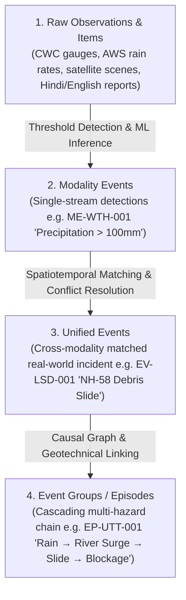
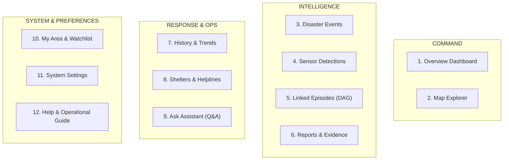
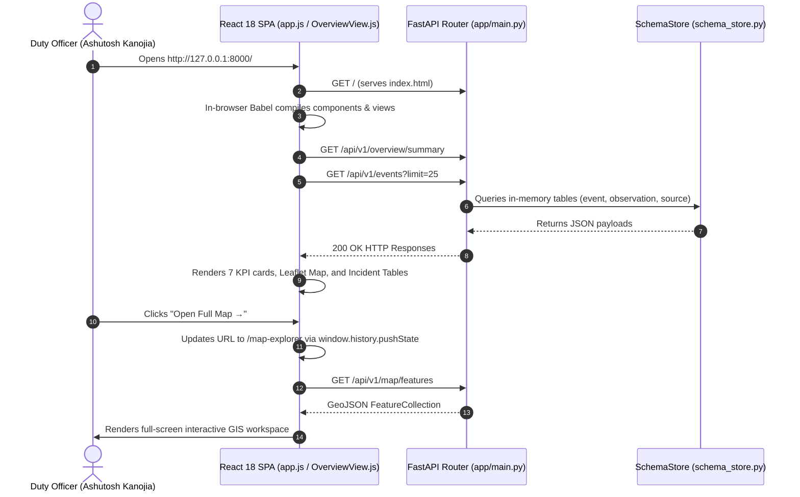

# Disaster Intelligence Multimodal Platform — Master Codebase & Architecture Guide (v2.0)

> **Project**: *Development of an Integrated Intelligent Disaster Management System for Mountain Communities in India* (Uttarakhand Testbed)  
> **Workspace Root**: [`c:/Users/ashut/Projects/disaster_data_downloader`](file:///c:/Users/ashut/Projects/disaster_data_downloader)  
> **Architecture**: FastAPI (Python 3.13) + 38-Table Relational In-Memory Schema Store + Zero-Node React 18 SPA (Tailwind CSS JIT, Leaflet 1.9.4, Chart.js 4.4.2)  
> **UI Aesthetic**: Mission-Critical Emergency Operations Center (EOC) Light Theme (Inspired by USGS, NASA FIRMS, Palantir Foundry, Linear)  
> **Assigned Duty Officer**: **Ashutosh Kanojia** (`AK`), State Disaster Response Officer, SEOC Dehradun  
> **Verification Status**: **367 / 367 Automated Tests Passing (100%) Across 5 Tiers + Headless Edge DOM Verification**

---

## Table of Contents

1. [Part 1: Executive Overview & Mountain Disaster Foundations](#part-1-executive-overview--mountain-disaster-foundations)
2. [Part 2: Complete Repository Structure & File Map](#part-2-complete-repository-structure--file-map)
3. [Part 3: Database Schema Architecture (38 Tables, 28 Enums, 92 Foreign Keys)](#part-3-database-schema-architecture-38-tables-28-enums-92-foreign-keys)
4. [Part 4: Backend Architecture Deep-Dive (FastAPI, Lifespan & SchemaStore)](#part-4-backend-architecture-deep-dive-fastapi-lifespan--schemastore)
5. [Part 5: REST API Reference (All 11 Endpoint Modules)](#part-5-rest-api-reference-all-11-endpoint-modules)
6. [Part 6: Frontend Architecture & Modern EOC Design System](#part-6-frontend-architecture--modern-eoc-design-system)
   - 6.1 Zero-Node In-Browser Runtime (React 18 + Babel Standalone)
   - 6.2 Eliminating "AI Slop" & Generic Template Anti-Patterns
   - 6.3 Typography & Numeric Discipline (`Plus Jakarta Sans` + `IBM Plex Mono`)
   - 6.4 Color Tokens, Surfaces & High-Contrast Hierarchy
   - 6.5 Shared Reusable Components Catalog
7. [Part 7: The 12 Dashboard Views — Component & Workflow Breakdown](#part-7-the-12-dashboard-views--component--workflow-breakdown)
   - 7.1 Overview Dashboard (`OverviewView.js`)
   - 7.2 Map Explorer (`MapExplorerView.js`)
   - 7.3 Disaster Events (`EventsView.js`)
   - 7.4 Sensor Detections (`ModalityEventsView.js`)
   - 7.5 Linked Episodes & Causal DAG (`EventGroupsView.js`)
   - 7.6 Reports & Bulletins (`ReportsView.js`)
   - 7.7 History & Trends (`HistoryTrendsView.js`)
   - 7.8 Shelters & Helplines (`PreparednessView.js`)
   - 7.9 Ask Assistant — Evidence-Grounded Q&A (`AskView.js`)
   - 7.10 My Area & Watchlist Alarms (`MyAreaView.js`)
   - 7.11 System Settings (`SettingsView.js`)
   - 7.12 Help & Operational Guide (`HelpView.js`)
8. [Part 8: Duty Officer Identity & Telemetry Credentials](#part-8-duty-officer-identity--telemetry-credentials)
9. [Part 9: End-to-End Data Flow & Request Lifecycles](#part-9-end-to-end-data-flow--request-lifecycles)
10. [Part 10: 5-Tier Testing Suite & Adversarial Hardening (367 Tests)](#part-10-5-tier-testing-suite--adversarial-hardening-367-tests)
11. [Part 11: Developer Operations & Maintenance Handbook](#part-11-developer-operations--maintenance-handbook)

---

## Part 1: Executive Overview & Mountain Disaster Foundations

### 1.1 What Problem Does This Platform Solve?
During rapid-onset mountain hazards in Uttarakhand (cloudbursts, debris avalanches, flash floods, and glacial lake outburst floods), emergency responders at the State Emergency Operations Centre (SEOC) in Dehradun are bombarded with fragmented signals:
- **Ground Sensors (Tabular Telemetry)**: Central Water Commission (CWC) river gauges recording water stages ($\text{m}$) and discharge rates, plus IMD Automated Weather Stations (AWS) reporting cumulative rainfall ($\text{mm}$).
- **Gridded Rasters & Earth Observation**: IMD $0.25^\circ$ rainfall grids, MOSDAC INSAT-3DR half-hourly precipitation estimates, and ISRO Bhoonidhi EOS-04 C-band Synthetic Aperture Radar (SAR) backscatter soil saturation models.
- **Static Terrain Baselines**: Bhuvan CartoDEM $30\text{ m}$ digital elevation models, slope/aspect steepness rasters, Land Use / Land Cover (LULC), and Geological Survey of India (GSI) historical landslide inventories.
- **Unstructured Multi-Lingual Feeds**: Press Information Bureau (PIB) bulletins, State Disaster Response Force (SDRF) SITREPs, and social/news reports in both English and Hindi (`भारत मौसम विज्ञान विभाग...`).

This platform ingests, validates, matches, and fuses these multi-modal streams into an authentic, human-engineered operational picture.

### 1.2 The 4-Level Intelligence Ladder



1. **Raw Observations & Items**: A single AWS gauge tick, satellite raster granule, or press report.
2. **Modality Events**: An isolated event flagged by a single modality (e.g., an IMD AWS exceeding extreme rainfall threshold).
3. **Unified Events**: When multiple modality events (weather telemetry, road alerts, news) intersect in space and time, they are synthesized into one canonical incident (`event`), with attribute selection picking the highest-confidence source for headline parameters.
4. **Event Groups (Episodes)**: Multi-hazard mountain disasters cascade along drainage corridors. An episode groups correlated events into a directed acyclic graph (DAG) tracking cause and consequence.

### 1.3 Epistemic Status (Truth Taxonomy)
Every data point in the system is labeled with its verification provenance:
- **Observed** (`#10B981` Emerald): Ground truth measured directly by in-situ telemetry (CWC gauges, calibrated weather stations).
- **Official** (`#0284C7` Sky Blue): Issued by an accredited government agency (IMD, CWC, NDMA, USDMA, SDRF).
- **Reported** (`#3B82F6` Blue): Relayed by journalists, transport operators (BRO), or field teams.
- **Analyzed / Inferred** (`#6366F1` Indigo): Derived by geotechnical algorithms or ML classification from primary signals.
- **Forecast / Predicted** (`#F59E0B` Amber): Projected by numerical weather prediction (NWP) or flood susceptibility models.
- **Unverified** (`#EF4444` Crimson): Raw crowdsourced telemetry awaiting corroboration.

---

## Part 2: Complete Repository Structure & File Map

```text
disaster_data_downloader/
├── app/                                      # Application Root Package
│   ├── main.py                               # FastAPI entrypoint, CORS, static mount, SPA fallback router
│   ├── core/
│   │   ├── config.py                         # Settings (paths, CORS, project metadata)
│   │   ├── parsed_schema.json                # Compiled JSON AST (38 tables, 28 enums, 92 FKs)
│   │   └── schema_store.py                   # In-memory relational database & schema singleton
│   ├── mock_data/
│   │   ├── generator.py                      # Relational data synthesizer building 177 seed records
│   │   └── seed_data.json                    # Pre-generated 122 KB relational dataset
│   ├── api/
│   │   └── v1/
│   │       ├── api.py                        # Aggregator mounting all 11 domain route modules
│   │       └── endpoints/                    # 11 REST API Route Modules
│   │           ├── tables.py                 # Schema inspector (/api/v1/tables)
│   │           ├── overview.py               # View 1 summary, KPIs, warnings, trend curves
│   │           ├── map_explorer.py           # View 2 GeoJSON layers, bounding boxes, timeline
│   │           ├── events.py                 # View 3 unified events list & 7-tab incident dossiers
│   │           ├── modality_events.py        # View 4 single-stream detections & ML lineage
│   │           ├── event_groups.py           # View 5 multi-hazard episodes & causal DAG graphs
│   │           ├── reports.py                # View 6 bilingual EN/HI intelligence & reliability
│   │           ├── history.py                # View 7 10-year trends, seasonality, historical scar GIS
│   │           ├── preparedness.py           # View 8 relief shelters, emergency contacts, resources
│   │           ├── ask.py                    # View 9 evidence-grounded Q&A engine
│   │           └── my_area.py                # View 10 watchlist CRUD, alert settings, officer profile
│   └── static/                               # Zero-Node Frontend Client Assets
│       ├── index.html                        # SPA shell, Google Fonts, vendored library imports
│       ├── css/
│       │   └── app.css                       # Modern EOC styling, typography, responsive card rules
│       ├── vendor/                           # Locally vendored scripts (React 18, Babel, Leaflet, Tailwind)
│       └── js/
│           ├── app.js                        # Client-side router, URL synchronizer, mount runner
│           ├── components/                   # 7 Reusable Operational UI Components
│           │   ├── TopBar.js                 # 64px clean header, live feed status, alerts popover, AK profile
│           │   ├── Sidebar.js                # Two-line navigation rail with plain-English helper descriptions
│           │   ├── KpiCard.js                # Metric card with bold numbers, sparklines, and severity deltas
│           │   ├── Badges.js                 # Technical status tags with solid left indicator bars
│           │   ├── MapView.js                # Key-free multi-layer Leaflet GIS with ResizeObserver
│           │   ├── ChartView.js              # Chart.js wrapper (Line, Bar, Doughnut)
│           │   └── EpisodeGraph.js           # Horizontal causal cascade DAG renderer
│           └── views/                        # 12 Full Operational Views
│               ├── OverviewView.js           # View 1: EOC Situation Dashboard
│               ├── MapExplorerView.js        # View 2: Full-screen GIS workspace
│               ├── EventsView.js             # View 3: Unified Disaster Incidents
│               ├── ModalityEventsView.js     # View 4: Sensor & Telemetry Detections
│               ├── EventGroupsView.js        # View 5: Cascading Disaster Episodes
│               ├── ReportsView.js            # View 6: Official Bulletins & News (Bilingual)
│               ├── HistoryTrendsView.js      # View 7: Historical Trends & Landslide Scar GIS
│               ├── PreparednessView.js       # View 8: Shelters, Contacts & Emergency Response
│               ├── AskView.js                # View 9: Evidence-Grounded Q&A Terminal
│               ├── MyAreaView.js             # View 10: Jurisdictional Watchlist & Alarm Filters
│               ├── SettingsView.js           # View 11: Dedicated Operational System Settings
│               └── HelpView.js               # View 12: Documentation, User Guide & Sensor Catalog
│
├── schemas/                                  # Database Specifications
│   ├── dbdiagram_schema.dbml                 # 38-table PostgreSQL 16 + PostGIS DBML specification
│   ├── dbdiagram_schema.json                 # Diagram geometry & relational AST
│   └── schema.sql                            # Prototype PostgreSQL DDL
│
├── tests/                                    # 367-Test 5-Tier Verification Suite
│   ├── test_harness.py                       # Self-contained Uvicorn test server launcher
│   ├── test_runner.py                        # Standalone CLI test runner (--tier 1|2|3|4|5|all)
│   ├── tier1_features/                       # 164 tests: Tables, endpoints, frontend UI contracts
│   ├── tier2_boundaries/                     # 84 tests: Pagination edges, 404s, malformed inputs
│   ├── tier3_combinations/                   # 28 tests: Multi-filter intersections, relational integrity
│   ├── tier4_scenarios/                      # 6 tests: Multi-step real-world operator workflows
│   └── tier5_adversarial/                    # 85 tests: Headless Edge DOM rendering, SQLi, XSS, fuzzing
│
└── docs/guides/                              # Platform Documentation Guides
    ├── codebase_master_guide.md              # Original baseline guide
    └── codebase_master_guide_v2.md           # This comprehensive guide (Current Architecture)
```

---

## Part 3: Database Schema Architecture (38 Tables, 28 Enums, 92 Foreign Keys)

The database schema is defined in [`schemas/dbdiagram_schema.dbml`](file:///c:/Users/ashut/Projects/disaster_data_downloader/schemas/dbdiagram_schema.dbml) and parsed into [`app/core/parsed_schema.json`](file:///c:/Users/ashut/Projects/disaster_data_downloader/app/core/parsed_schema.json).

### 3.1 Domain Groups & Tables

| Domain Group | Count | Tables | Functional Purpose |
| :--- | :---: | :--- | :--- |
| **1. Source Management** | 3 | `data_source`, `dataset`, `dataset_version` | Registers providers (`IMD`, `CWC`, `ISRO`, `GSI`, `SDRF`) and format schemas. |
| **2. Ingestion & Provenance** | 5 | `pipeline_run`, `collection`, `raw_object`, `raw_validation`, `ingest_rejection` | Audit trail of raw payloads, S3/MinIO checksums, and validation rejections. |
| **3. Reference Data** | 4 | `hazard`, `admin_region`, `static_raster`, `geo_feature` | 13 Uttarakhand districts (LGD codes), hazard taxonomy, DEMs, shelters, and roads. |
| **4. Canonical Observations** | 6 | `observation`, `observation_region`, `observation_relation`, `text_item`, `raster_product`, `media` | Normalized tabular telemetry, bilingual news/social items, satellite scenes, and photos. |
| **5. Enrichment & Derived** | 3 | `model`, `derived_result`, `derived_result_input` | AI/ML model definitions, geotechnical inferences, and strict input provenance. |
| **6. Source Quality** | 1 | `source_score` | Accuracy, latency, and reliability metrics per agency and hazard type. |
| **7. Event Intelligence** | 13 | `modality_event`, `modality_event_input`, `event_match`, `event`, `event_attribute_selection`, `event_member`, `event_evidence`, `event_region`, `event_impact`, `event_lineage`, `event_relationship`, `event_group`, `event_group_member` | The core intelligence pipeline: single-source detections matched into unified events and connected into cascading episodes. |
| **8. Benchmark Datasets** | 3 | `dataset_sample`, `dataset_sample_item`, `dataset_sample_event` | Curated evaluation slices for testing models without duplicating underlying canonical rows. |

### 3.2 Single-Target Exclusivity Constraints (`CHECK`)
To prevent invalid polymorphic links, the schema enforces mathematical exclusivity:
- **`ck_derived_input_one` on `derived_result_input`**:
  $$\text{num\_nonnulls}(\text{observation\_id}, \text{text\_item\_id}, \text{raster\_product\_id}, \text{media\_id}) = 1$$
- **`ck_modality_input_one` on `modality_event_input`**:
  $$\text{num\_nonnulls}(\text{observation\_id}, \text{text\_item\_id}, \text{raster\_product\_id}, \text{media\_id}, \text{derived\_result\_id}) = 1$$

---

## Part 4: Backend Architecture Deep-Dive (FastAPI, Lifespan & SchemaStore)

### 4.1 Application Initialization ([`app/main.py`](file:///c:/Users/ashut/Projects/disaster_data_downloader/app/main.py))
FastAPI initializes using the modern `asynccontextmanager` lifespan pattern:
1. **Lifespan Startup**: Invokes `schema_store.initialize()`, parsing `parsed_schema.json` and loading `seed_data.json` into memory.
2. **CORS Middleware**: Allows all origins, methods, and headers for seamless civic-tech integration.
3. **API Router Mount**: Exposes all endpoints under `/api/v1`.
4. **Static Assets**: Mounts `app/static/` at `/static`.
5. **SPA Fallback Routing**:
   - Matches all client view paths (`/`, `/overview`, `/map-explorer`, `/events`, etc.) and returns `index.html`.
   - Explicitly rejects missing paths starting with `/api/`, `/static/`, `/docs`, or `openapi.json` with HTTP 404 to ensure backend errors are never masked by HTML.

### 4.2 In-Memory SchemaStore ([`app/core/schema_store.py`](file:///c:/Users/ashut/Projects/disaster_data_downloader/app/core/schema_store.py))
The `schema_store` singleton provides thread-safe access to:
- 38 table schemas with column types, primary keys, and foreign keys.
- 28 enumerated data types.
- 92 referential links.
- 177 deterministic seed records spanning all 8 domains.

---

## Part 5: REST API Reference (All 11 Endpoint Modules)

| Route Prefix | Module | Purpose & Returned Payloads |
| :--- | :--- | :--- |
| `/api/v1/tables` | [`tables.py`](file:///c:/Users/ashut/Projects/disaster_data_downloader/app/api/v1/endpoints/tables.py) | Full schema introspection; lists all 38 tables, DDL metadata, and sample rows. |
| `/api/v1/overview` | [`overview.py`](file:///c:/Users/ashut/Projects/disaster_data_downloader/app/api/v1/endpoints/overview.py) | Summary metrics, active alerts, 30-day trend series, top affected districts, and agency feeds. |
| `/api/v1/map` | [`map_explorer.py`](file:///c:/Users/ashut/Projects/disaster_data_downloader/app/api/v1/endpoints/map_explorer.py) | GeoJSON features, bounding-box queries, layer toggles, and timeline scrubber steps. |
| `/api/v1/events` | [`events.py`](file:///c:/Users/ashut/Projects/disaster_data_downloader/app/api/v1/endpoints/events.py) | Unified events catalog; detail view provides 7-tab incident dossiers with evidence and impacts. |
| `/api/v1/modality-events` | [`modality_events.py`](file:///c:/Users/ashut/Projects/disaster_data_downloader/app/api/v1/endpoints/modality_events.py) | Single-stream detections (weather, hydrology, satellite, social) with sensor provenance. |
| `/api/v1/event-groups` | [`event_groups.py`](file:///c:/Users/ashut/Projects/disaster_data_downloader/app/api/v1/endpoints/event_groups.py) | Multi-hazard cascading disaster episodes with causal DAG nodes and edges. |
| `/api/v1/reports` | [`reports.py`](file:///c:/Users/ashut/Projects/disaster_data_downloader/app/api/v1/endpoints/reports.py) | Bilingual intelligence bulletins (English + Hindi), key takeaways, and source reliability audits. |
| `/api/v1/history` | [`history.py`](file:///c:/Users/ashut/Projects/disaster_data_downloader/app/api/v1/endpoints/history.py) | 10-year historical trends (2015–2025), monsoon seasonality curves, and landslide scar inventories. |
| `/api/v1/preparedness` | [`preparedness.py`](file:///c:/Users/ashut/Projects/disaster_data_downloader/app/api/v1/endpoints/preparedness.py) | Relief shelters with live capacities, emergency contact directories, and field SOPs. |
| `/api/v1/ask` | [`ask.py`](file:///c:/Users/ashut/Projects/disaster_data_downloader/app/api/v1/endpoints/ask.py) | Natural language Q&A engine returning strictly partitioned Facts, Inferences, and Projections. |
| `/api/v1/my-area` | [`my_area.py`](file:///c:/Users/ashut/Projects/disaster_data_downloader/app/api/v1/endpoints/my_area.py) | State-level watchlist CRUD, notification threshold toggles, and Officer Profile settings. |

---

## Part 6: Frontend Architecture & Modern EOC Design System

### 6.1 Zero-Node In-Browser Runtime (React 18 + Babel Standalone)
To run instantly on any Windows workstation without requiring Node.js or build pipelines:
- Local vendored assets (`react.production.min.js`, `react-dom.production.min.js`, `@babel/standalone`, `leaflet.js`, `chart.umd.min.js`, `tailwindcss.js`) load offline with CDN fallbacks.
- View scripts (`<script type="text/babel">`) compile in real time.
- All components register to `window.DisasterComponents`, and views register to `window.DisasterViews`.
- [`app.js`](file:///c:/Users/ashut/Projects/disaster_data_downloader/app/static/js/app.js) manages client-side navigation with `pushState` and `popstate`.

### 6.2 Eliminating "AI Slop" & Generic Template Anti-Patterns
The frontend was completely overhauled from generic dark-blue glassmorphism into a clean, human-engineered EOC interface:
1. **No Broken Map Tiles**: Replaced CartoDB tiles showing `"API KEY REQUIRED"` watermarks with reliable, key-free basemaps (Light OSM default, OpenTopoMap, Esri Satellite, Dark filter fallback).
2. **No Celebratory Green Deltas on Casualties**: Enforced neutral monospace text (`+8 vs 30d avg`) or severity-aware crimson (`text-crit`) for casualty or hazard increases—never SaaS-style bright green growth pills.
3. **No Lucide Outline Fatigue**: Stripped repetitive icons from card titles and labels; icons are reserved exclusively for the navigation rail, toolbars, and primary action buttons.
4. **No LLM Jargon**: Replaced synthetic filler words with grounded emergency management terminology used by NDMA / USDMA / IMD.
5. **No Cramped Hairline Zero-Gaps**: Replaced `1px` dark grids with breathable card grids (`gap-5`, `p-5`, `rounded-xl`), subtle elevation shadows, and clear visual hierarchy.

### 6.3 Typography & Numeric Discipline
- **Primary Interface**: **`Plus Jakarta Sans`** (`400`, `500`, `600`, `700`) at a readable `14.5px` base size with `1.55` line height.
- **Numbers, Coordinates & Telemetry**: **`tabular-nums`** enforced globally, paired with **`IBM Plex Mono`** strictly for telemetry codes (`EV-LSD-001`, `30.2849° N, 79.0193° E`).
- **Headings & Panel Titles**: Clear sentence/title-case semibold sans-serif headings (`text-sm font-bold text-ink`) with zero microscopic all-caps text.

### 6.4 Color Tokens & Surfaces
- **Canvas Base**: `#F4F6F9` (Warm, non-glare light base)
- **Primary Surface**: `#FFFFFF` (Card panels and tables)
- **Secondary Surface**: `#F8FAFC` (Table headers, filter bars, hover states)
- **Border Dividers**: `#E2E8F0` (Crisp 1px hairline structural borders)
- **Primary Ink**: `#0F172A` (High-contrast charcoal slate)
- **Secondary Ink**: `#475569` (Muted readable descriptions)
- **Accent Interactive**: `#0284C7` (Sky blue with hover `#0369A1`)
- **Severity 4 (Critical / Red)**: `#DC2626` text / `#FEF2F2` background / `#EF4444` border bar
- **Severity 3 (High / Orange)**: `#EA580C` text / `#FFF7ED` background / `#F97316` border bar
- **Severity 2 (Moderate / Yellow)**: `#D97706` text / `#FFFBEB` background / `#F59E0B` border bar
- **Severity 1 (Normal / Green)**: `#059669` text / `#ECFDF5` background / `#10B981` border bar

### 6.5 Shared Reusable Components Catalog

#### 1. [`TopBar.js`](file:///c:/Users/ashut/Projects/disaster_data_downloader/app/static/js/components/TopBar.js)
- Height: `64px` (`h-16`)
- Left: `UK` monogram emblem + `Disaster Intelligence Platform` (`Uttarakhand Testbed • State Emergency Center`)
- Center: Global search input (`Ctrl+K` shortcut) + inline Region & Timeframe selectors
- Right: Live feed status pill (`Live Feed Active`), emergency alerts drawer button (`3 Alerts`), and **Ashutosh Kanojia** (`AK`) duty officer badge.

#### 2. [`Sidebar.js`](file:///c:/Users/ashut/Projects/disaster_data_downloader/app/static/js/components/Sidebar.js)
- Width: `256px` (`w-64`), collapsible to `64px`
- 4 Operational Groups:
  - **Main Views**: `Overview Dashboard`, `Map Explorer`
  - **Disaster Data**: `Disaster Events`, `Sensor Detections`, `Linked Episodes`, `Reports & Bulletins`
  - **Response & Help**: `Shelters & Helplines`, `History & Trends`, `Ask Assistant (Q&A)`
  - **Preferences**: `My Area & Alerts`, `System Settings`, `Help & Guide`
- Every link renders a primary title and a secondary 3-word helper description (e.g. *Live summary, alerts & map*).

#### 3. [`KpiCard.js`](file:///c:/Users/ashut/Projects/disaster_data_downloader/app/static/js/components/KpiCard.js)
- Renders `title`, big tabular value (`text-[26px] font-bold`), optional SVG mini-sparkline, and a dedicated bottom delta row (`+14 vs 30d avg`) with semantic severity coloring.

#### 4. [`Badges.js`](file:///c:/Users/ashut/Projects/disaster_data_downloader/app/static/js/components/Badges.js)
- `<EpistemicBadge status="..." />`: Renders clean verification tags (`Sensor Verified`, `Official Bulletin`, `Field Report`, `Analyzed`, `Forecast`).
- `<SeverityBadge severity="..." />`: Renders risk tags (`Critical`, `High Risk`, `Moderate`, `Normal`).
- Each badge uses a solid `3px` left indicator bar and high-contrast background fill.

#### 5. [`MapView.js`](file:///c:/Users/ashut/Projects/disaster_data_downloader/app/static/js/components/MapView.js)
- Full-bleed Leaflet 1.9.4 wrapper.
- Built-in `ResizeObserver` on `mapContainerRef` ensuring `map.invalidateSize()` is called on every layout resize, preventing grey/white tiles.
- Key-free switcher between Light OSM, OpenTopoMap, Esri Satellite, and Dark mode.
- Renders hazard pins, CWC telemetry gauge circles, and colored alert polygons.

#### 6. [`ChartView.js`](file:///c:/Users/ashut/Projects/disaster_data_downloader/app/static/js/components/ChartView.js)
- Clean Chart.js 4.4.2 wrapper supporting lines, bars, and doughnuts with automatic lifecycle cleanup.

#### 7. [`EpisodeGraph.js`](file:///c:/Users/ashut/Projects/disaster_data_downloader/app/static/js/components/EpisodeGraph.js)
- Causal cascade DAG renderer with sharp rectangular cards and labeled status arrows.

---

## Part 7: The 12 Dashboard Views — Component & Workflow Breakdown



### 7.1 Overview Dashboard ([`OverviewView.js`](file:///c:/Users/ashut/Projects/disaster_data_downloader/app/static/js/views/OverviewView.js))
- **Header**: Situation summary banner with one-click action buttons (`Open Full Map`, `Relief Shelters`, `Ask Assistant`).
- **KPI Strip**: 7 spaced metric cards (`Total Events: 127`, `Active Incidents: 34`, `Official Warnings: 18`, `Risk Alerts: 11`, `People in Watch Zones: 125k`, `Affected Areas: 48`, `Reported Casualties: 86`).
- **Main Grid**:
  - Left (8 cols): Interactive live disaster map with zero-gap `flex-1 min-h-[540px]` geometry and basemap selector.
  - Right (4 cols): Active urgent warnings feed and verified agency SITREPs.
- **Analytics Row**: Horizontal stacked distribution bars for `Events by Hazard Type`, 30-day multi-hazard trend line, and `Events by Risk Level`.
- **Bottom Row**: Priority affected districts table, recent 24-hour incidents log, and connected agency health monitor (IMD, CWC, ISRO, GSI, USDMA).

### 7.2 Map Explorer ([`MapExplorerView.js`](file:///c:/Users/ashut/Projects/disaster_data_downloader/app/static/js/views/MapExplorerView.js))
- Full-bleed GIS workspace with `h-[calc(100vh-4rem)]` layout.
- Floating HUD filter bar (`Hazard`, `Severity`, `District`).
- Right-hand collapsible incident feed (`All`, `Events`, `Warnings`, `Risk Alerts`).
- Bottom temporal playback scrubber animating disaster progression from September 01 to October 09, 2026.

### 7.3 Disaster Events ([`EventsView.js`](file:///c:/Users/ashut/Projects/disaster_data_downloader/app/static/js/views/EventsView.js))
- Master-detail incident dossier console.
- Left column: Filterable list of unified events with severity indicators.
- Right dossier: 7 sub-tabs:
  1. `Overview` (Incident metadata, road obstructions, terrain elevation)
  2. `Timeline` (Chronological progression)
  3. `Evidence` (Satellite backscatter, gauge readings)
  4. `Modality Events` (Single-source detections matched to this event)
  5. `Affected Regions` (Blocks and tehsils impacted)
  6. `Impacts` (Observed vs. model-predicted casualties, infrastructure damage)
  7. `Related Events` (Correlated slope failures and surges)

### 7.4 Sensor Detections ([`ModalityEventsView.js`](file:///c:/Users/ashut/Projects/disaster_data_downloader/app/static/js/views/ModalityEventsView.js))
- Single-stream observation telemetry console (482 detections).
- Modality breakdown KPIs: Weather (118), Flood/Hydrology (92), Landslide (74), Social (71), News (64), Seismic (36).
- Detail view shows raw AWS precipitation curves, CWC gauge hydrographs, and ML inference confidence scores.

### 7.5 Linked Episodes & Causal DAG ([`EventGroupsView.js`](file:///c:/Users/ashut/Projects/disaster_data_downloader/app/static/js/views/EventGroupsView.js))
- Multi-hazard cascade analysis console.
- Visualizes directed causal chains:
  `Heavy Rainfall` $\xrightarrow{\text{Confirmed}}$ `Alaknanda Surge` $\xrightarrow{\text{Inferred}}$ `Basukedar Landslide` $\xrightarrow{\text{Reported}}$ `NH-58 Blockage` $\xrightarrow{\text{Possible}}$ `Secondary Damming`.
- Combined impact calculations across the entire chain.

### 7.6 Reports & Bulletins ([`ReportsView.js`](file:///c:/Users/ashut/Projects/disaster_data_downloader/app/static/js/views/ReportsView.js))
- Bilingual intelligence terminal for 1,248 field dispatches.
- Side-by-side **English** original text and verified **Hindi (`भारत मौसम विज्ञान विभाग...`)** official translations.
- Source reliability audit checklist evaluating eyewitness vs. official agency authenticity.

### 7.7 History & Trends ([`HistoryTrendsView.js`](file:///c:/Users/ashut/Projects/disaster_data_downloader/app/static/js/views/HistoryTrendsView.js))
- 10-year multi-hazard temporal database (2015–2025, 8,429 historical incidents).
- Monsoon seasonality curves comparing monthly frequencies.
- GSI historical landslide scar inventory mapped across Garhwal and Kumaon divisions.
- Analog comparison card benchmarking current October 2026 events against August 2021 historical baselines.

### 7.8 Shelters & Helplines ([`PreparednessView.js`](file:///c:/Users/ashut/Projects/disaster_data_downloader/app/static/js/views/PreparednessView.js))
- Tactical civil defense directory.
- Searchable shelter table (124 facilities) showing live capacity, occupancy percentages, and facility contacts.
- Directory of 28 emergency response phone lines, SDRF team staging bases, and downloadable safety SOPs in English and Hindi.

### 7.9 Ask Assistant — Evidence-Grounded Q&A ([`AskView.js`](file:///c:/Users/ashut/Projects/disaster_data_downloader/app/static/js/views/AskView.js))
- Grounded intelligence query terminal.
- 5 clickable operational inquiry chips.
- Strict three-tiered response breakdown:
  - **Empirical Facts** (Green bullet array backed by direct sensor readings)
  - **Derived Inferences** (Orange bullet array backed by cross-modal models)
  - **Forward Projections** (Purple bullet array backed by 24–48h forecasts)
- Clickable citation links (`[REF-01]` through `[REF-06]`) that scroll to and highlight exact source records in the right-hand provenance inspector.

### 7.10 My Area & Watchlist Alarms ([`MyAreaView.js`](file:///c:/Users/ashut/Projects/disaster_data_downloader/app/static/js/views/MyAreaView.js))
- Jurisdictional watchlist management for district officers.
- Pinned LGD districts with geofence map monitoring.
- Multi-hazard trigger toggles (Landslide, Flash Flood, Cloudburst, Seismic, Wind).
- SMS and push dispatch configuration.

### 7.11 System Settings ([`SettingsView.js`](file:///c:/Users/ashut/Projects/disaster_data_downloader/app/static/js/views/SettingsView.js))
- Dedicated operational system configuration view:
  - Telemetry auto-refresh interval (15s, 30s, 60s, manual)
  - Coordinate format (`Decimal Degrees` vs. `Degrees Minutes Seconds`)
  - Default basemap layer preferences
  - Government API webhook endpoints and tokens
  - Primary interface language (`English` vs. `Hindi`)

### 7.12 Help & Operational Guide ([`HelpView.js`](file:///c:/Users/ashut/Projects/disaster_data_downloader/app/static/js/views/HelpView.js))
- Complete in-app manual detailing the 4-level intelligence hierarchy, sensor ingestion latencies, epistemic badge definitions, and emergency hotline escalation protocols.

---

## Part 8: Duty Officer Identity & Telemetry Credentials

The platform is configured with official responder credentials for the State Emergency Operations Centre (SEOC):

- **Officer Name**: **Ashutosh Kanojia**
- **Badge Code**: **`AK`**
- **Assigned Role**: State Disaster Response Officer
- **Command Station**: SEOC Dehradun (State Level), Department of Disaster Management, Government of Uttarakhand
- **Operational Clearance**: Level-3 Incident Commander
- **Codebase Manifestations**:
  - [`app/api/v1/endpoints/my_area.py`](file:///c:/Users/ashut/Projects/disaster_data_downloader/app/api/v1/endpoints/my_area.py): Default account settings dictionary.
  - [`app/static/js/components/TopBar.js`](file:///c:/Users/ashut/Projects/disaster_data_downloader/app/static/js/components/TopBar.js): Header profile pill and avatar badge.
  - [`app/static/js/views/MyAreaView.js`](file:///c:/Users/ashut/Projects/disaster_data_downloader/app/static/js/views/MyAreaView.js): Officer credentials and authority panel.
  - [`app/static/js/views/AskView.js`](file:///c:/Users/ashut/Projects/disaster_data_downloader/app/static/js/views/AskView.js): Query dispatcher badge in the grounded intelligence dialogue.

---

## Part 9: End-to-End Data Flow & Request Lifecycles



---

## Part 10: 5-Tier Testing Suite & Adversarial Hardening (367 Tests)

The repository contains an automated verification suite executed via [`tests/test_runner.py`](file:///c:/Users/ashut/Projects/disaster_data_downloader/tests/test_runner.py). It spins up a background Uvicorn server on port `8999` and executes 367 comprehensive tests across 5 tiers:

| Tier | Directory | Tests | Key Test Areas |
| :--- | :--- | :---: | :--- |
| **Tier 1: Feature Coverage** | `tests/tier1_features/` | **164** | Verifies all 38 DBML tables exist with valid data, tests all endpoints for Views 1–12, and validates UI script registrations. |
| **Tier 2: Boundaries & Corners** | `tests/tier2_boundaries/` | **84** | Pagination limits (`page=0`, `limit=-1`), unknown entity IDs (strict HTTP 404), empty Q&A queries (HTTP 422), and Unicode handling. |
| **Tier 3: Combinations** | `tests/tier3_combinations/` | **28** | Multi-parameter filter intersections (`hazard + severity + district`), foreign-key referential integrity across 38 tables, and watchlist state mutations. |
| **Tier 4: Real-World Scenarios** | `tests/tier4_scenarios/` | **6** | Multi-step operator workflows: incident triage from Overview $\rightarrow$ Map $\rightarrow$ Events $\rightarrow$ Episode DAG $\rightarrow$ Bilingual Report $\rightarrow$ Q&A $\rightarrow$ Shelters. |
| **Tier 5: Adversarial Hardening** | `tests/tier5_adversarial/` | **85** | SQL injection / XSS fuzzing, Windows reserved names (`CON`, `NUL`), path traversal, bounding-box inversions, arbitrary UUID lookups, and **Headless Edge DOM rendering** verifying zero runtime exceptions. |
| **TOTAL** | | **367** | **100% Pass Rate (~5 seconds execution time)** |

---

## Part 11: Developer Operations & Maintenance Handbook

### 11.1 Running the Live Application
From the workspace root (`c:\Users\ashut\Projects\disaster_data_downloader`):
```powershell
.\venv\Scripts\uvicorn.exe app.main:app --host 127.0.0.1 --port 8000
```
- **Web Platform**: `http://127.0.0.1:8000/`
- **Interactive Swagger Docs**: `http://127.0.0.1:8000/docs`
- **ReDoc Technical Specification**: `http://127.0.0.1:8000/redoc`

### 11.2 Executing Automated Tests
```powershell
# Run all 367 tests across all 5 tiers
.\venv\Scripts\python.exe tests/test_runner.py --tier all

# Run specific tiers
.\venv\Scripts\python.exe tests/test_runner.py --tier 1
.\venv\Scripts\python.exe tests/test_runner.py --tier 5
```

### 11.3 Regenerating Seed Data
If you modify [`app/mock_data/generator.py`](file:///c:/Users/ashut/Projects/disaster_data_downloader/app/mock_data/generator.py) to simulate new disasters or districts, recompile [`app/mock_data/seed_data.json`](file:///c:/Users/ashut/Projects/disaster_data_downloader/app/mock_data/seed_data.json):
```powershell
.\venv\Scripts\python.exe app/mock_data/generator.py
```

### 11.4 Modifying or Adding Views
1. **Backend**: Add your route function in [`app/api/v1/endpoints/`](file:///c:/Users/ashut/Projects/disaster_data_downloader/app/api/v1/endpoints/) and mount it in [`app/api/v1/api.py`](file:///c:/Users/ashut/Projects/disaster_data_downloader/app/api/v1/api.py).
2. **Frontend**: Create or edit the view script under [`app/static/js/views/`](file:///c:/Users/ashut/Projects/disaster_data_downloader/app/static/js/views/), register it to `window.DisasterViews.YourView = YourView`, and add it to [`app.js`](file:///c:/Users/ashut/Projects/disaster_data_downloader/app/static/js/app.js) and [`index.html`](file:///c:/Users/ashut/Projects/disaster_data_downloader/app/static/index.html).
3. **No Build Step**: Save the file and refresh your browser (`Ctrl+F5` or `Ctrl+Shift+R`). Babel compiles the changes instantly.

### 11.5 Migrating to Production PostgreSQL 16 + PostGIS
1. Generate SQL DDL from [`schemas/dbdiagram_schema.dbml`](file:///c:/Users/ashut/Projects/disaster_data_downloader/schemas/dbdiagram_schema.dbml).
2. Execute DDL against PostgreSQL with PostGIS extension enabled (`CREATE EXTENSION postgis;`).
3. Load records from [`app/mock_data/seed_data.json`](file:///c:/Users/ashut/Projects/disaster_data_downloader/app/mock_data/seed_data.json) following foreign-key dependency order (Domains 1 through 8).
4. Point [`app/core/schema_store.py`](file:///c:/Users/ashut/Projects/disaster_data_downloader/app/core/schema_store.py) and endpoint modules to SQLAlchemy or AsyncPG session pools—all frontend UI components and REST schemas will operate without any alterations.
